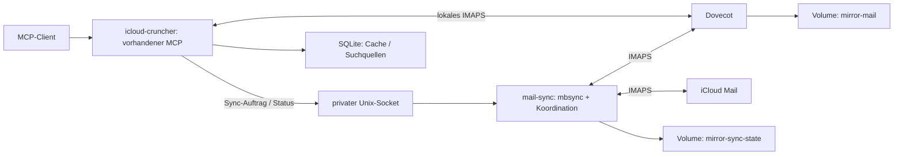

# Konzept: lokaler iCloud-Mail-Spiegel und Serverauswahl

Stand: 4. Oktober 2026. Architekturvorschlag; noch keine Laufzeitänderung oder
Erprobung mit einem echten iCloud-Konto.

Der unten beschriebene Dovecot-Aufbau ist die Variante mit Wiederverwendung
unserer bestehenden IMAP-/MCP-Werkzeuge. Für möglichst viele integrierte
Funktionen ist Stalwart der erste Vergleichskandidat. Dovecot mit Full Text
Search ist die zweite Variante: Auch damit lässt sich vorhandene
Serverfunktionalität nutzen, statt Mail-/PDF-Volltextsuche selbst aufzubauen.
Die Auswahl soll anhand von Suche, Anhängen, MCP-Kompatibilität und Sync
erfolgen. Ein `mbsync`-Abgleich und die Behandlung unklarer Schreibresultate
bleiben bei beiden Kandidaten ein gesonderter Integrationspunkt.

**Alternativen und fertige MCP-Anbindungen**

| Lösung | MCP-Anbindung | Eignung für dieses Projekt |
| --- | --- | --- |
| Dovecot + mbsync + vorhandener MCP | Unsere Mail-Werkzeuge existieren bereits. | Vorhandene IMAP-/MCP-Werkzeuge nutzbar; Volltext- und Anhangssuche über fertige Erweiterungen. |
| Stalwart + separater MCP-Adapter | Community-Adapter sprechen JMAP; beispielsweise `webpatser/stalwart-mcp` oder `codeChap/mcp-server-stalwart`. | Mailhaltung, interne Volltextsuche und JMAP integriert. Der iCloud-Sync bleibt eine zusätzliche Aufgabe. |
| EmailEngine | Native MCP-Mailwerkzeuge; laut Hersteller derzeit Beta. | Fertige IMAP/API-Brücke mit eigener Lizenz. Speichert keine vollständigen Mailinhalte lokal; ein Mirror-Server und Sync bleiben zusätzlich nötig. |
| `wildsurfer/your-mail-mcp` | Fertiger MCP-Dienst mit lokalem Maildir, mbsync und notmuch. | Nahe an einem fertigen Lesespiegel; ausdrücklich ohne Schreibfunktionen und Rücksynchronisierung. Kein Ersatz für den gewünschten schreibbaren lokalen IMAP-Server. |

Stalwart bietet IMAP und JMAP. Die gefundenen MCP-Projekte sind eigenständige
Adapter, keine dokumentierte MCP-Funktion des Mailserver-Kerns. Der Adapter
von webpatser dokumentiert auch Streamable HTTP; ein Docker-Image steht in
seiner Roadmap. Das wäre daher eine weitere zu paketierende und zu prüfende
Komponente. Quellen: [Stalwart-Protokolle](https://www.stalwart.email/docs/email/),
[webpatser/stalwart-mcp](https://github.com/webpatser/stalwart-mcp),
[codeChap/mcp-server-stalwart](https://github.com/codeChap/mcp-server-stalwart).

`your-mail-mcp` kombiniert Spiegelung und lokale Suche, ist laut Projekt
bewusst nur lesend und bezeichnet sich als bislang wenig extern erprobt.
Es eignet sich, wenn Lesen und Suchen genügen. Für Markieren, Verschieben
und Entwürfe müsste es erheblich erweitert werden.
Quelle: [your-mail-mcp](https://github.com/wildsurfer/your-mail-mcp).

**Welche eigenen Komponenten der Server übernehmen kann**

Stalwart bringt eine interne Volltextsuche mit; dafür ist kein externer
Suchdienst nötig. JMAP bietet eine JSON-Schnittstelle für Mailzugriffe.
Damit kann der Server Mail-Metadaten, normalen Suchindex und Mailhaltung
übernehmen, die wir bisher teilweise selbst in Python/SQLite verwalten.
Welche binären Anhangsformate zuverlässig extrahiert werden, insbesondere
PDFs, ist vor der Auswahl konkret zu prüfen. Die allgemeine Dokumentation
zur Anhangssuche reicht nicht für eine Zusage zur PDF-Extraktion.
Quellen: [Stalwart-Volltextsuche](https://www.stalwart.email/docs/storage/fts/),
[Stalwart-Mailprotokolle](https://www.stalwart.email/docs/email/).

Dovecot CE hat mit `fts_flatcurve` einen lokalen Volltextindex. Die
Anhangsextraktion lässt sich über Apache Tika anbinden. Das benötigt
Konfiguration und einen Decoder-Dienst; es ist keine Zusage, dass das
unveränderte Docker-Image alle Module enthält. Für den gewählten Tag müssen
Module und Konfiguration geprüft werden.
Quelle: [Dovecot Full Text Search](https://doc.dovecot.org/latest/core/plugins/fts.html).

Beide Varianten übernehmen wortbasierte Suche. Eine semantische Suche nach
Bedeutung mit unseren Embeddings wird dadurch nicht ersetzt. Qdrant und die
zugehörige Verarbeitung bleiben nur für diese zusätzliche Funktion nötig.
Wenn wir auf die semantische Funktion verzichten wollen, ist das eine
explizite Produktentscheidung und keine automatische Folge des Serverwechsels.

Normale Mailzugriffe im Mirror-Modus sollen direkt den lokalen Server nutzen;
der bisherige SQLite-Mail-Lesecache entfällt. SQLite kann Kalender-Cache und
den verbleibenden Verarbeitungs-/Batch-Status halten. Die unten beschriebene
temporäre BLOB-Verarbeitung betrifft ausschließlich die optionale semantische
Indexierung, nicht den normalen IMAP-Zugriff.

EmailEngine bietet native MCP-Werkzeuge für Lesen, Suche, Anhänge, Flags,
Verschieben, Löschen und Entwürfe. Es verwendet Redis für seinen Account- und
Nachrichtenindex, holt Inhalte und Anhänge jedoch vom verbundenen Mailserver.
Es kann deshalb eine fertige MCP-Schicht vor einem lokalen Dovecot oder
Stalwart sein, spart aber den lokalen Server und dessen iCloud-Sync nicht.
Die Produktionslizenz sowie Kompatibilität mit unseren Bestätigungsregeln
und nativen MCP-Anhangsdateien sind vor einer Ablösung zu prüfen.
Quellen: [EmailEngine MCP](https://learn.emailengine.app/docs/mcp),
[EmailEngine Datenhaltung](https://learn.emailengine.app/docs/configuration/redis),
[EmailEngine Lizenz](https://learn.emailengine.app/docs/licensing).

Keiner der geprüften Kandidaten liefert einen belegten, integrierten
bidirektionalen Spiegel zwischen zwei aktiv bearbeiteten Postfächern mit
unserer gewünschten Schreibbestätigung. Stalwarts dokumentierter
IMAP-Import ist ein Migrationspfad über ein Archiv; er ersetzt den laufenden
Rückabgleich zu iCloud nicht.
Quelle: [Stalwart Import/Export](https://www.stalwart.email/docs/migration/import-export/).

**Zielarchitektur**



Dovecot hält vollständige Nachrichten einschließlich Anhängen. Python führt
normale Mail-Operationen gegen Dovecot aus. Nur der Sync-Dienst verbindet
sich für den Mail-Spiegel mit iCloud. iCloud bleibt das externe Postfach;
lokale, noch nicht synchronisierte Änderungen bilden einen eigenen Zustand.

Für die erste Implementierung werden zwei IMAP-Stores gekoppelt. Nur Dovecot
schreibt direkt in seinen Mailspeicher; der Sync-Dienst greift ebenfalls über
IMAP darauf zu. Damit entfallen gemeinsam beschriebene Maildir-Dateien und
die Abstimmung unterschiedlicher Dateisystem-UID-Verwaltungen. Die konkrete
Kombination mit iCloud wird vor produktiven Schreibzugriffen im PoC geprüft.

Ein lokaler Spiegel benötigt weiterhin einen automatischen Erstdownload.
Danach sollen reguläre Abfragen keine Verbindung zu iCloud benötigen.
Große Postfächer werden zuerst mit INBOX und danach mit den übrigen Ordnern
befüllt; der Status zeigt die noch unvollständige Abdeckung.

**Docker und Konfiguration**

Ein optionales Compose-Profil `mail-mirror` ergänzt zwei Dienste:

- `mail-mirror`: Dovecot mit festem Versionstag und Digest, persistentem
  `mirror-mail`-Volume, explizitem lokalen Benutzer und TLS-Zertifikat.
- `mail-sync`: gepinnte isync-Version mit kleinem Coordinator, eigenem
  `mirror-sync-state`-Volume und einem privaten Unix-Socket für Python.

Ein zusätzliches `docker-compose.mail-mirror.yml` überschreibt die
Mail-Konfiguration von `icloud-cruncher`. Das Profil allein ändert seine
Umgebungsvariablen nicht. Als Startziel ist vorgesehen:

```sh
docker compose -f docker-compose.yml -f docker-compose.mail-mirror.yml --profile mail-mirror up -d
```

Für das rootless Dovecot-Image dokumentiert der Hersteller IMAPS auf Port
`31993`, Konfigurationsdateien unter `/etc/dovecot/conf.d` und persistenten
Speicher unter `/srv/vmail`, schreibbar für UID 1000. Die konkrete
Konfiguration muss zur gewählten Dovecot-2.4-Version passen. Unbenötigte
Protokolle werden deaktiviert; Authentifizierung wird auf den eingerichteten
Benutzer beschränkt. Quelle:
[Dovecot in Docker](https://doc.dovecot.org/latest/installation/docker.html).

Python erhält `IMAP_HOST=mail-mirror`, `IMAP_PORT=31993`, einen lokalen
`IMAP_USERNAME` und ein eigenes lokales `IMAP_APP_PASSWORD`. Das historische
Variablennamen-Schema kann zunächst erhalten bleiben. Die lokale CA wird
gezielt im Container vertraut; die Zertifikatsprüfung bleibt aktiv. Das ist
relevant, weil `app/imap.py` bereits ausschließlich `IMAP4_SSL` mit geprüftem
TLS verwendet. Nur Host und Port umzustellen reicht bei einem unvertrauten
lokalen Zertifikat nicht.

Der Sync-Dienst erhält getrennte `MIRROR_REMOTE_*`- und `MIRROR_LOCAL_*`-Werte.
Apple-Zugangsdaten werden als Secret-Dateien eingebunden. Kalender kann
weiterhin die bisherigen Apple-Zugangsdaten benötigen. Dovecot erhält nur
das lokale Passwort. Neue Dienste veröffentlichen keine Host-Ports; optionaler
Mailclient-Zugriff wird separat über Loopback vorgesehen.

**Sync-Auslöser und sichtbares Verhalten**

Der Coordinator startet beim Hochfahren den Erstabgleich, danach beispielsweise
alle 60 Sekunden einen Abgleich. Nach einer lokalen MCP-Schreiboperation
wird ein Auftrag für die betroffenen Ordner eingereiht und nach kurzer
Bündelung sofort bearbeitet. Mehrere Aufträge werden zusammengefasst; pro
Account läuft höchstens ein Sync. Aufträge und letzter erfolgreicher Lauf
überleben Neustarts. Die Steuerung benötigt keine zusätzlichen öffentlichen
HTTP-Routen.

Strukturänderungen und Sync teilen eine Sperre, damit ein laufender Abgleich
eine lokale Verschiebung nicht zwischen Zielkopie und Quellentfernung sieht.
Der Auftrag wird vor der lokalen Mutation dauerhaft angelegt; ein Absturz
zwischen Mutation und Statusspeicherung führt zu einer Zustandsprüfung.
Diese Koordination gehört zum Integrationsaufwand für schreibenden Betrieb.

Zwei ergänzende MCP-Werkzeuge sind vorgesehen: `email_sync_status` für
Abdeckung, Zeitpunkt und sichere Fehlercodes sowie `sync_emails` zum
Auslösen eines Abgleichs. Ihre Beschreibung muss erklären, dass ein Abgleich
bereits autorisierte lokale Änderungen nach iCloud übertragen kann.

Schreibantworten unterscheiden `local_applied` und `sync_status`. Bei einem
iCloud-Ausfall kann die lokale Änderung abgeschlossen und der Abgleich
`pending` sein. Ein abgeschlossener mbsync-Lauf bedeutet zunächst
`reconciled`; die Bestätigung einer einzelnen Remote-Operation erfordert
zusätzliche Prüfung. Ein Timeout darf nicht dazu führen, dass Python die
lokale Operation erneut ausführt.

Beispiel: `mark_email_read` setzt lokal das Leseflag und liefert
`local_applied=true`, `sync_status=pending`. Der Coordinator startet den
Ordnerabgleich. Lesen und Suchen funktionieren während eines iCloud-Ausfalls
weiter gegen den bereits befüllten lokalen Speicher. Kalender und Reminders
dürfen weder auf den Erstabgleich warten noch durch einen Sync-Ausfall am
Start gehindert werden.

**Was ein Standard-Sync abdeckt und wo eigene Logik nötig wird**

mbsync unterstützt UID-basierten Abgleich mit persistiertem Zustand,
beiden Richtungen und auswählbaren Operationstypen. Es kann IMAP-Stores
koppeln. Seine Konfiguration unterscheidet verschwundene Nachrichten,
Flags und Expunge; `Deleted` gehört zu den Flags. Ein Ordnerabgleich kann
alle seit dem letzten Lauf anstehenden Änderungen dieser Ordner übernehmen.
Quelle: [mbsync-Handbuch](https://isync.sourceforge.io/mbsync.html).

Für den Einstieg wird angenommen: MCP ist der einzige lokale Schreibclient;
iPhone und andere Clients dürfen weiterhin direkt auf iCloud arbeiten.
Ein Schreibaufruf löst einen Abgleich betroffener Ordner aus. Er garantiert
keine exklusive Übertragung genau dieser einen Änderung. Falls einzelne
Änderungen beliebig zurückgehalten oder separat freigegeben werden sollen,
brauchen wir zusätzlich ein eigenes Operationsjournal mit Zuordnung zu
Remote-UIDs. Ein gewöhnlicher bidirektionaler Sync bietet diese Semantik
nicht allein durch seinen Aufrufzeitpunkt.

Nach dem lesenden PoC werden Flags und neue Entwürfe freigeschaltet.
Verschieben, Entwurfsersetzung und Löschen folgen mit eigener Prüfung:

- Ein Move kann im Abgleich als neue Nachricht im Ziel und Entfernung aus
  der Quelle erscheinen. Zielordner zuerst abgleichen; vor Entfernen der
  Remote-Quelle muss die Zielkopie nachgewiesen sein. Scheitert dieser
  Nachweis, bleibt die Quelle erhalten und der Auftrag offen.
- Entwurfsersetzung erzeugt eine neue Nachricht und entfernt die alte.
  Für Abbrüche gilt dieselbe Reihenfolge; erhaltene Kopien und neue IDs
  müssen sichtbar bleiben.
- `delete_email` behält `confirm=true`. Kein pauschales Remote-Expunge,
  das fremde bereits als gelöscht markierte Nachrichten mit entfernt.
  Selektive Entfernung mit geprüften UIDPLUS-Fähigkeiten und verlässlicher
  UID-Zuordnung ist eine Voraussetzung für endgültiges Remote-Löschen.
  Ohne diese Voraussetzung bleibt die Funktion gesperrt oder ausdrücklich
  beim Markieren stehen. `Expunge None` allein verhindert noch keine
  Übertragung des Deleted-Flags.

Ein abgebrochener Lauf kann Remote-Änderungen bereits ausgeführt haben.
Nach einer unklaren Kopie, einem Move oder Löschen wird zuerst der Zustand
rekonstruiert; ein Timer darf die unklare Schreibsequenz nicht blind erneut
starten. Für betroffene Ordner kann der Push pausieren, während andere
Abgleiche weiterlaufen. Auch verlorener Sync-Zustand und echte
UIDVALIDITY-Wechsel erfordern einen gesonderten Wiederaufbau statt eines
ungeprüften Push aus dem vorhandenen Spiegel.

`imapsync` ist für Migration sinnvoll, wird aber vom eigenen Projekt für
zwei gleichzeitig bearbeitete Postfächer ausdrücklich nicht empfohlen.
Deshalb ist es hier nicht die bevorzugte Sync-Engine.
Quelle: [imapsync: Grenzen](https://imapsync.lamiral.info/).

**Integration in das bestehende Repository**

`app/config.py` ergänzt einen expliziten Mirror-Modus und Sync-Einstellungen;
im Mirror-Modus sind dedizierte lokale Credentials erforderlich. Ein
stillschweigender Rückgriff auf Apple-Zugangsdaten soll dort entfallen.
`app/imap.py` bleibt für die IMAP-Operationen zuständig.
Ein neues `app/mail_mirror.py` kapselt Aufträge und Status;
`app/main.py` verbindet den Coordinator mit dem Lebenszyklus.
`app/mcp_server.py` ergänzt Status und Sync-Auslöser und passt die
Werkzeugbeschreibungen an lokale Schreibbestätigung an.

Lokale und Remote-UIDs sind getrennte Identitäten. Bestehende Referenzen
auf iCloud-UIDs dürfen nach Umschaltung nicht auf Dovecot angewandt werden.
Account-/Backend-Identität, Mailbox, UIDVALIDITY und UID müssen geprüft werden,
auch bei Mutationen. Alte Referenzen werden abgewiesen. Die aktuelle
Cache-Identität enthält bereits Host, Port und Benutzer und trennt damit
beide Speicher; Werkzeugreferenzen brauchen dieselbe eindeutige Bindung.

Für den produktiven Mirror ist eine einzige dauerhafte Ablage vollständiger
Mails einschließlich Anhängen vorgesehen: Dovecot. SQLite enthält weiterhin
Kalender-Cache, Mail-Metadaten, Quellenidentitäten und Index-/Batch-Status.
Qdrant hält abgeleitete Textabschnitte und Suchvektoren, keine vollständigen
Nachrichten oder binären Anhänge. Diese Suchdaten benötigen zusätzlichen
Speicher; dessen Größe hängt von Inhalten, Chunk-Anzahl und Vektordimension ab.

Ein reines Umstellen des vorhandenen Crawlers auf Dovecot würde dagegen einen
zweiten vollständigen Mailbestand in SQLite aufbauen. Das ist für einen
begrenzten PoC möglich, aber nicht das Ziel für den produktiven Betrieb.
Die Trennung der Suchquellen von den dauerhaft gespeicherten Rohmails gehört
deshalb zur Mirror-Implementierung.

Der separate lokale Importer stellt für die Indexierung bei Bedarf begrenzte,
temporäre, account-scoped `.eml`-BLOBs in SQLite bereit. Die semantische
Indexierung verarbeitet weiterhin ausschließlich diese SQLite-Snapshots und
ruft selbst kein IMAP ab. Nach gesicherter Verarbeitung können Rohdaten
entfallen. Quellenmetadaten, Generation und Inhaltsdigest bleiben erhalten;
das Entfernen eines Verarbeitungs-BLOBs darf keine Suchtreffer invalidieren.
Eine tatsächliche Entfernung aus Dovecot muss sie weiterhin invalidieren.
Verarbeitung und Batch-Wiederaufnahme benötigen ein gemeinsames Speicherlimit
und Backpressure, damit aus temporären Daten kein zweites Archiv wird.

Auch Embeddings werden heute sowohl in SQLite als Wiederverwendungscache als
auch in Qdrant gehalten. Dieser Cache spart erneute Embedding-Aufrufe; für den
Mirror wird er begrenzt und bereinigt. Ohne ihn würde ein Neuaufbau des
Qdrant-Index unter Umständen neue Embedding-Kosten verursachen. Das ist eine
bewusste Cache-Entscheidung, keine weitere vollständige Mailkopie.

Sync-Läufe lösen eine Generation für geänderte Ordner aus. Python muss damit
Quellenmetadaten aktualisieren, verschwundene UIDs aus Suchquellen entfernen
und neue Inhalte bei Bedarf lokal einlesen. Ein Flag-Wechsel sollte nicht
sämtliche unveränderten Inhalte und Vektoren neu aufbauen. In-flight-Crawler
dürfen invalidierte Generationen nicht erneut veröffentlichen. Nach einem
Worker-Neustart muss ein vollständiger lokaler UID-Abgleich verlorene
Änderungssignale ausgleichen. Logging enthält nur Status, Dauer und Zähler;
rohe Sync-Ausgabe wird nicht ungefiltert in Containerlogs übernommen.

**Umsetzungsreihenfolge und Abnahme**

1. Zwei lokale Test-IMAP-Server aufsetzen, einen als iCloud-Ersatz. Image,
   TLS, Authentifizierung und persistente Volumes prüfen. Erstabgleich nur
   lesend vom Quellserver, lokale MCP-Mutationen zunächst gesperrt.
2. Python auf Dovecot umstellen. Suche, vollständige Nachrichten, Anhänge,
   Cache und vorhandene semantische Suche prüfen. Vor produktivem Vollimport
   Quellenmetadaten von Roh-BLOBs trennen und temporäre Verarbeitung sowie
   Embedding-Cache begrenzen. Sync-Status und Wiederaufnahme eines
   unterbrochenen Erstdownloads ergänzen.
3. Rücksynchronisierung für Flags und neue Entwürfe ergänzen. Paralleländerungen,
   doppelte Nachrichten/Message-IDs, Offlinebetrieb, Neustarts und
   UIDVALIDITY-Wechsel testen. Den festgelegten Konfliktausgang dokumentieren;
   keine globale atomare Transaktion versprechen.
4. Move, Entwurfsersetzung und bestätigtes Löschen mit gezielten Abbruchtests
   freischalten. Unklare Remote-Ergebnisse, fehlende Fähigkeiten und fremde
   Deleted-Flags müssen die vorgesehenen Grenzen einhalten.

Der produktive Einstieg kann mit einem ausschließlich lesenden iCloud-Sync
beginnen. Live-Schreibtests werden erst separat geplant und autorisiert.
Mirror-Maildaten und Sync-Zustand werden konsistent gemeinsam gesichert;
nach Restore startet kein Push vor Prüfung der Zuordnung. Ein Spiegel ersetzt
kein historisches Backup, sobald Löschungen synchronisiert werden.

Für die Implementierung gehören `uv run pytest`, eine geheimnisfreie
Compose-Validierung sowie Image-Builds zu den erforderlichen Checks.
Dieses Konzept allein verändert weder Code, Abhängigkeiten noch Compose.
